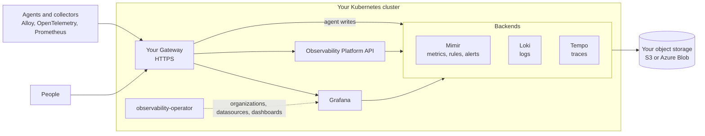

# Observability Platform

**Metrics, logs, traces and alerting on your own Kubernetes: Mimir, Loki, Tempo and Grafana in one Helm chart, multi-tenant, with all data in object storage you own.**

---

The Observability Platform takes proven open-source projects, [Mimir](https://github.com/grafana/mimir), [Loki](https://github.com/grafana/loki), [Tempo](https://github.com/grafana/tempo) and [Grafana](https://github.com/grafana/grafana), and packages them as one platform for metrics, logs, traces, dashboards and alerting. Organizations, datasources, dashboards, alert routing and agent credentials are Kubernetes resources, so the platform is configured the same way as everything else on the cluster.

It is built from the components behind the [observability platform](https://docs.giantswarm.io/overview/observability/) that [Giant Swarm](https://www.giantswarm.io) runs for its customers. This chart installs them on any conformant cluster, such as kind or EKS, without a Giant Swarm management cluster.

> [!NOTE]
> The chart is in active development and has no tagged release yet. You install it from this repository, and its values may still change.

## Components

Each component can be switched on or off. A default install runs everything except the Observability Platform API.

| Component | What it does |
|---|---|
| [Mimir](https://github.com/giantswarm/mimir-app) | Multi-tenant metrics storage, with the ruler for recording and alerting rules and the Alertmanager that routes alerts to your receivers. |
| [Loki](https://github.com/giantswarm/loki-app) | Multi-tenant log storage, queried with LogQL. |
| [Tempo](https://github.com/giantswarm/tempo-app) | Multi-tenant trace storage, queried with TraceQL. |
| [Grafana](https://github.com/giantswarm/grafana-app) | Dashboards, data exploration and alert management across all three signals. |
| [observability-operator](https://github.com/giantswarm/observability-operator) | Turns Kubernetes resources into platform configuration: Grafana organizations with their datasources, dashboards, Alertmanager configs and agent credentials. Installed as its own release, before the chart. |
| [observability-platform-api](https://github.com/giantswarm/observability-platform-api) | One authenticated HTTPS endpoint for reading and writing all three signals from outside the cluster, with JWTs from your OIDC issuer. Opt-in. |

Related projects, not part of the chart:

- [Alloy](https://github.com/giantswarm/alloy-app) is the OpenTelemetry collector Giant Swarm uses to ship metrics, logs and traces to the platform.
- [mcp-observability-platform](https://github.com/giantswarm/mcp-observability-platform) is an MCP server that exposes Grafana and its Mimir, Loki, Tempo and Alertmanager datasources to AI agents.

## Why Observability Platform

- **One chart, one storage setting.** A single value picks the object storage backend for Mimir, Loki and Tempo together.
- **Open source only.** Every component is open source and your data stays in buckets you own.
- **Multi-tenant from the start.** Every write and read names its tenant, and a Grafana organization maps to the tenants its people may see.
- **Configured through Kubernetes.** Organizations, dashboards, alert routing and agent credentials are resources you keep in Git.
- **The same on a laptop and in production.** One chart runs on kind with a bundled object store, and against S3 or Azure Blob Storage.

## Getting started

- **On your laptop:** `make local-up` runs the whole platform on kind. See [Local development](docs/LOCAL_DEV.md).
- **On a cluster:** follow the [Installation guide](docs/INSTALL.md).

## Documentation

| Page | What it covers |
|---|---|
| [Observability overview](https://docs.giantswarm.io/overview/observability/) | The concepts: multi-tenancy, Grafana organizations, dashboards, alerting, data ingestion. Written for Giant Swarm installations, the resources are the same here. |
| [Prepare your environment](https://docs.giantswarm.io/overview/observability/standalone/prepare-your-environment/) | Cluster, capacity, network and object storage requirements |
| [Installation guide](docs/INSTALL.md) | Prerequisites, network access, install and uninstall |
| [Grafana database](docs/GRAFANA_DATABASE.md) | Grafana on PostgreSQL with CloudNativePG, its secret key, backups to object storage, and keeping Grafana on SQLite |
| [Object storage](docs/OBJECT_STORAGE.md) | Buckets, credentials and values for S3 and Azure Blob Storage |
| [EKS cluster](docs/EKS_CLUSTER.md) | Creating a cluster the platform runs on, with `eksctl` |
| [Gateway](docs/GATEWAY.md) | Envoy Gateway, the Gateway, its certificate and its DNS record |
| [External API](docs/EXTERNAL_API.md) | Authenticated ingest and read from outside the cluster |
| [Agent credentials](docs/AGENT_CREDENTIALS.md) | Credentials for agents that push metrics, logs and traces |
| [Alerting](docs/ALERTING.md) | The default Alertmanager config and how to provide your own |
| [Local development](docs/LOCAL_DEV.md) | The kind setup, test data, smoke tests and chart unit tests |

## Contributing

Each component is developed in its own repository, linked above. This repository holds the chart that turns them into one platform, in [`helm/observability-platform`](helm/observability-platform). [Local development](docs/LOCAL_DEV.md) covers the kind setup and the tests.

Issues and pull requests are welcome. Please sign off your commits under the [DCO](DCO).

## Security

Please report vulnerabilities through [Giant Swarm's responsible disclosure](https://www.giantswarm.io/responsible-disclosure). See [SECURITY.md](SECURITY.md).

## License

[Apache 2.0](LICENSE).
